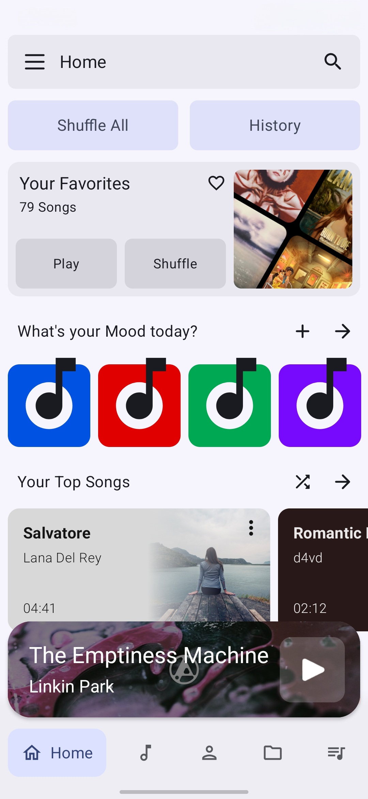
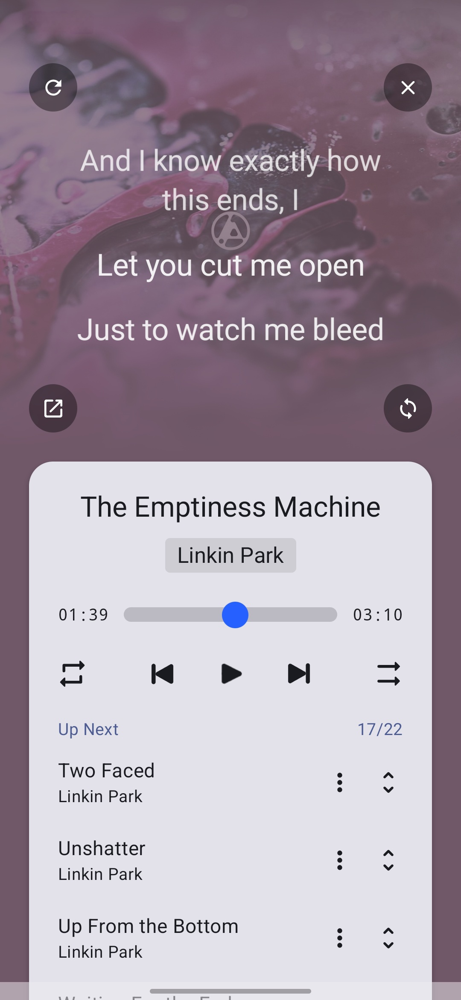
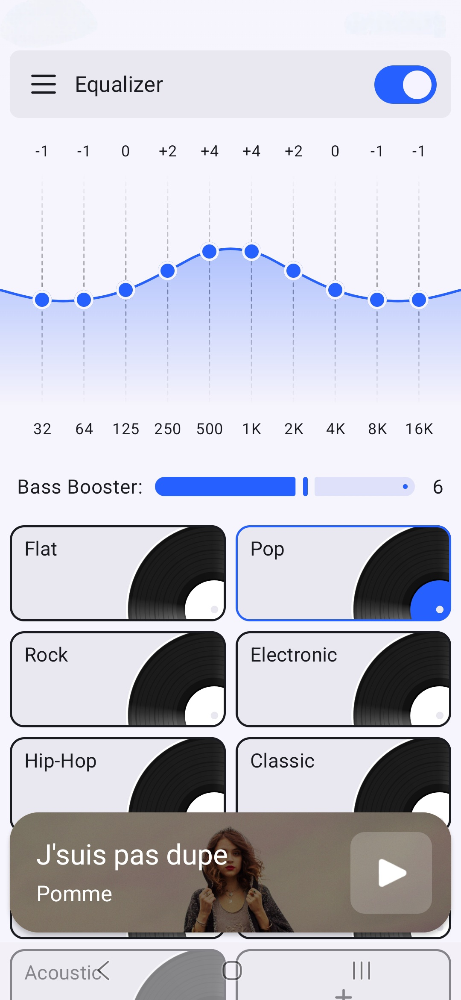
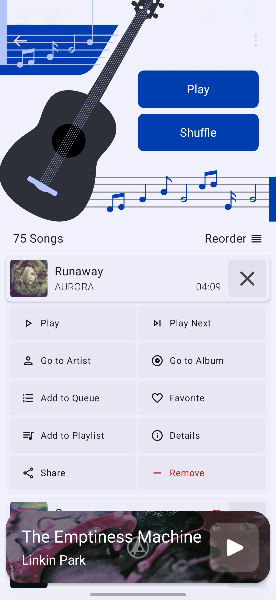
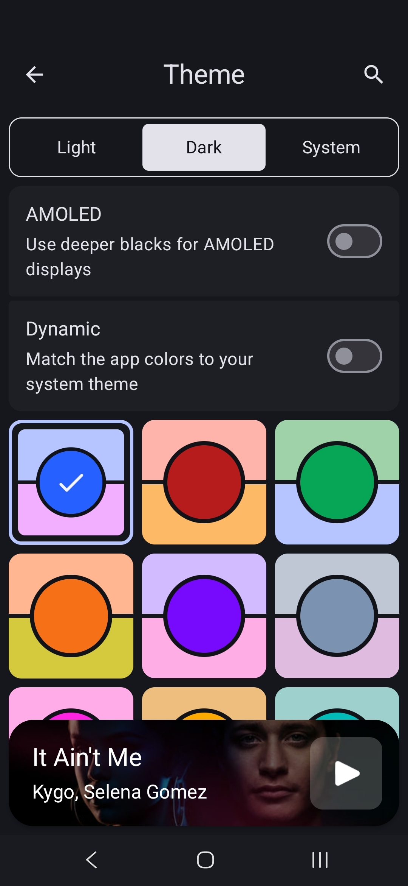

# Anathema

## A beautiful offline music player for Android

  

Anathema is a modern offline music player for Android that combines elegant Material Design, powerful audio tools, extensive customization, and a fast, intuitive experience. Built for people who love local music libraries, Anathema focuses on beauty, flexibility, and seamless everyday listening.

Available on:

  
  

## ✨ Features

Anathema is designed to provide a complete offline music experience, combining beautiful visuals, powerful audio controls, and smart tools that help you enjoy and organize your music exactly the way you want.

### 🎨 Beautiful & Customizable Interface

Personalize Anathema to match your style.

- Modern Material Design 3 interface
- Fully optimized Dark Mode
- Dynamic accent colors
- Custom fonts
- Multiple player layouts
- Extensive UI customization

### 🎵 Smart Music Organization

Go beyond traditional playlists.

With **Moods**, you can assign one or multiple color-coded labels to every song, making it easy to organize, filter, and rediscover your music library.

### 🎤 Synchronized Lyrics

Enjoy lyrics that stay perfectly in sync with your music.

- One-tap lyric search
- Line-by-line synchronized lyrics
- Fast online lyric loading

> Multi-language lyric translation is currently in development.

### ✏️ Metadata Editor

Edit your music library directly inside the app.

Future updates will introduce automatic metadata recognition and online matching.

### 🎚 Professional Equalizer

Fine-tune your listening experience.

- 10-band Equalizer
- Bass Boost
- Genre presets
- Unlimited custom presets

### ⏱ Playback Features

Everything you need for comfortable listening.

- Playback speed adjustment
- Sleep timer
- Smooth queue management

### 📊 Listening Statistics

Track your listening habits with automatically generated insights.

- Top Songs
- Top Artists
- Listening History
- Personalized recommendations based on your local library

### 🌍 Languages

Currently available in:

- English
- Persian (فارسی)

More languages are planned.

## 🖼 Screenshots

| Home | Player | Lyrics |
|------|--------|---------|
|  |  |  |

| Equalizer | Moods | Settings |
|-----------|--------|----------|
|  |  |  |

## 🚀 Roadmap

Planned features include:

- AI-powered metadata recognition
- Multi-language lyric translation
- Additional themes and player layouts
- Cloud backup & restore
- More personalization options

## 💬 Feedback

Found a bug or have an idea for a new feature?

Please open an Issue on GitHub.

Your feedback helps make Anathema better for everyone.

## ❤️ Support

If you enjoy using Anathema, you can support the project by:

- ⭐ Starring this repository
- 📢 Sharing the app with friends
- 📝 Leaving a review on the app store

Every bit of support helps Anathema continue to improve.

## 📄 License

This repository serves as the official homepage and public issue tracker for Anathema.

The Anathema application is proprietary software.

**All rights reserved.**
